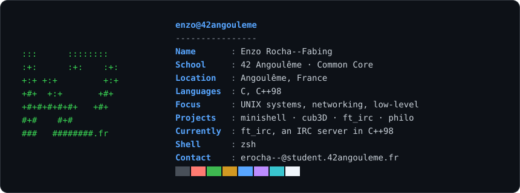
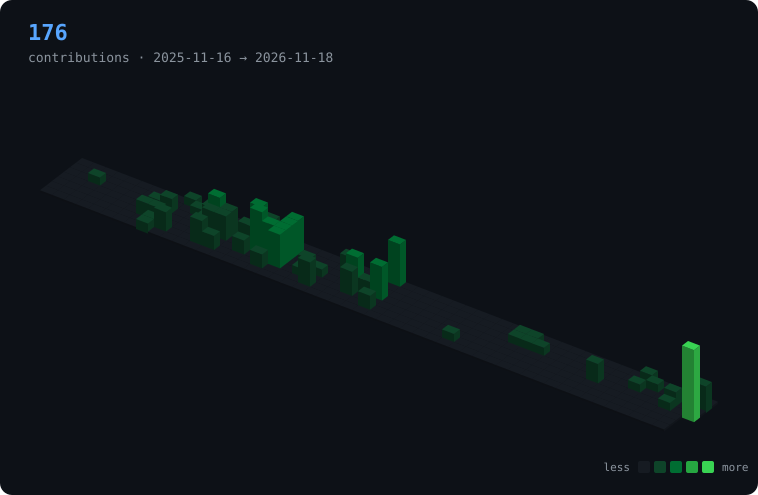

  

<h3><code>enzo@github ~ $ neofetch</code></h3>

  

<h3><code>enzo@github ~ $ ./contributions.sh</code></h3>

  

<h3><code>enzo@github ~ $ ls ~/42/</code></h3>

<table>
  <tr>
    <td width="50%" valign="top">
      <a href="https://github.com/erocha42/minishell"><b>minishell</b></a> <code>C</code> · team of 2 
      A bash-like shell: lexer and parser, pipes, redirections, heredoc, environment expansion, signals and built-ins.
    </td>
    <td width="50%" valign="top">
      <a href="https://github.com/erocha42/ft_irc"><b>ft_irc</b></a> <code>C++98</code> · team of 2 
      A non-blocking IRC server multiplexing every client with a single <code>poll()</code> loop.
    </td>
  </tr>
  <tr>
    <td valign="top">
      <a href="https://github.com/erocha42/cub3D"><b>cub3D</b></a> <code>C</code> · team of 2 
      A raycasting engine (DDA) with textured walls and Nextbots that chase the player.
    </td>
    <td valign="top">
      <a href="https://github.com/erocha42/philosophers"><b>philosophers</b></a> <code>C</code> 
      The dining philosophers problem with POSIX threads and mutexes, free of deadlocks and data races.
    </td>
  </tr>
  <tr>
    <td valign="top">
      <a href="https://github.com/erocha42/CPP-Modules"><b>CPP-Modules</b></a> <code>C++98</code> 
      OOP from the ground up: canonical form, inheritance, polymorphism, exceptions, casts, templates.
    </td>
    <td valign="top">
      <a href="https://github.com/erocha42/Push_Swap"><b>push_swap</b></a> <code>C</code> 
      Sorting with two stacks and a restricted instruction set, in as few moves as possible.
    </td>
  </tr>
  <tr>
    <td valign="top">
      <a href="https://github.com/erocha42/pipex"><b>pipex</b></a> <code>C</code> 
      Shell pipes rebuilt with <code>fork</code>, <code>execve</code>, <code>pipe</code> and <code>dup2</code>.
    </td>
    <td valign="top">
      <a href="https://github.com/erocha42/so_long"><b>so_long</b></a> <code>C</code> 
      A small 2D game with MiniLibX: map parsing, path validation and rendering.
    </td>
  </tr>
  <tr>
    <td valign="top" colspan="2" align="center">
      <a href="https://github.com/erocha42/netpractice"><b>netpractice</b></a> TCP/IP addressing, subnetting and routing
    </td>
  </tr>
</table>

 

<h3><code>enzo@github ~ $ cat stack.txt</code></h3>

  

